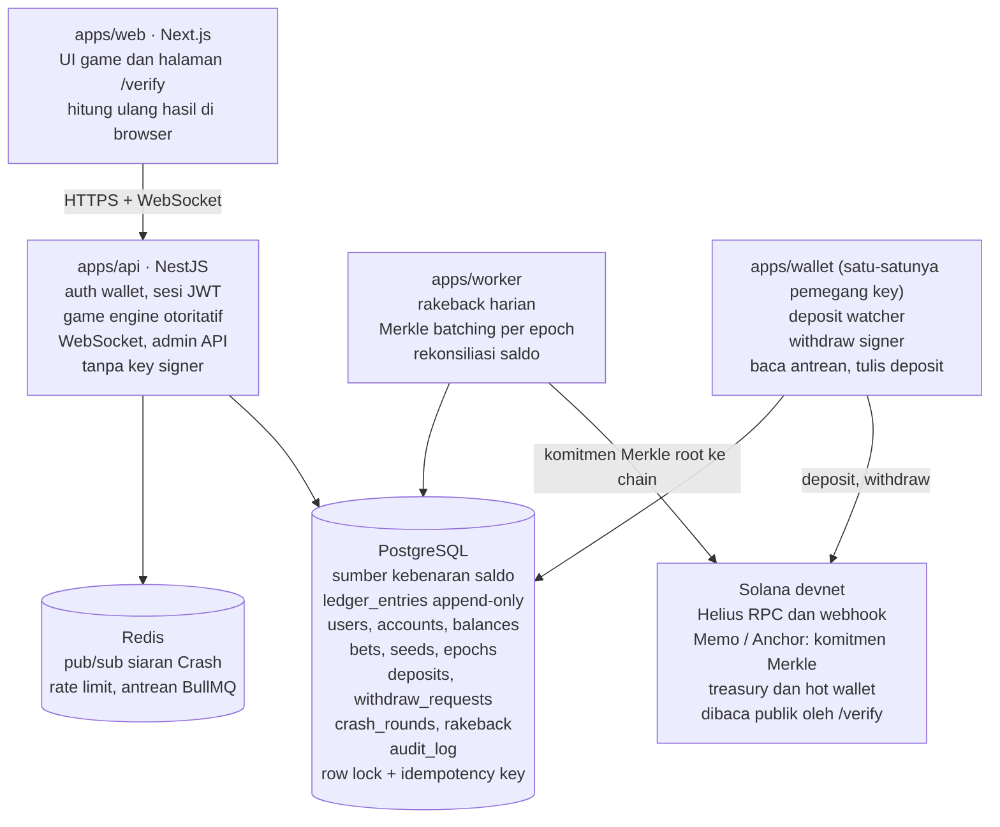

# PRD & Blueprint: Crypto Game Platform di Solana (Devnet)

Tanggal: 2026-10-26

## 1. Ringkasan dan Tujuan

Proyek ini adalah eksperimen teknis di **Solana devnet**: empat game (Dice, Crash, Plinko, Mines) dengan taruhan diproses off-chain, deposit/withdraw token devnet, dan komitmen seed provably fair yang dijangkarkan ke blockchain (Sumbu A). Tidak ada uang nyata dan tidak ada pengguna publik.

**Tujuan**

1. Membangun inti platform yang benar dan membosankan: ledger double-entry, auth, game engine otoritatif, wallet service.
2. Mempelajari Solana secara praktis lewat Sumbu A: transaksi Memo, program Anchor kecil, PDA, Merkle root komitmen, verifikasi on-chain.
3. Menghasilkan provably fair yang dapat diverifikasi pihak ketiga dengan halaman verifikasi publik dan vektor tes tetap.
4. Menjaga lapisan chain di balik antarmuka adapter, sehingga chain lain bisa ditambahkan tanpa menyentuh logika game dan ledger.

**Prinsip desain**

- Bagian yang bug-nya merugikan (ledger, auth, saldo) memakai pola standar dan terbukti. Eksperimen hanya di Sumbu A.
- Satu sumber kebenaran untuk saldo: ledger append-only. Saldo adalah hasil turunan, bukan kolom yang diubah-ubah.
- Server otoritatif untuk hasil game. Client hanya menampilkan.
- Kode provably fair ditulis sekali di `packages/fairness` dan dipakai server serta halaman verifikasi.
- Semua jumlah uang berupa integer dalam unit terkecil token, tidak pernah float.
- Monolit modular lebih dulu. Hanya wallet service yang dipisah proses karena menyentuh key.

## 2. Ruang Lingkup, Non-Goals, dan Asumsi

MVP mencakup Dice, Mines, Plinko, dan Crash di devnet, dengan dua token (SOL dan USDC devnet) serta komitmen seed on-chain. VIP dan cashback ditunda.

| Area | Masuk MVP | Ditunda | Tidak dikerjakan |
| --- | --- | --- | --- |
| Game | Dice, Mines, Plinko, Crash | Game tambahan | Live casino, sportsbook |
| Token | SOL, USDC (devnet) | Token SPL lain | Token volatil (BONK dll.) |
| Taruhan | Off-chain, server otoritatif | Betting on-chain (Sumbu C) | Smart contract kustodi dana |
| Fairness | Seed, nonce, HMAC, halaman verifikasi, komitmen on-chain | VRF (Switchboard/ORAO) | Klaim "fully trustless" |
| Akun | Email + wallet login, seed management | KYC | Verifikasi identitas pihak ketiga |
| Bonus | Rakeback flat | VIP tier, cashback | Referral, afiliasi |
| Sosial | Recent bets | Chat, leaderboard | Streaming, tip antar user |
| Admin | Dashboard dasar (saldo, bankroll, ledger) | Panel risiko lanjutan | Back-office multi-peran |

**Asumsi**

- Semua berjalan di devnet dengan token tanpa nilai. Jika tujuan berubah ke pengguna dan uang nyata, proyek berhenti di gerbang hukum (bagian 18) sebelum fase berikutnya.
- Pengembang tunggal. Itu sebabnya monolit modular, bukan microservice.
- RPC: Helius (free tier) untuk devnet. RPC publik tidak dipakai sebagai satu-satunya jalur karena rate limit.
- Geoblocking dan lisensi hanya dicatat sebagai syarat produksi, tidak diimplementasikan di MVP.

**Non-goals tegas:** tidak menargetkan pasar Indonesia, tidak menerima dana nyata, tidak menjadikan prototipe ini produk publik tanpa tinjauan hukum.

## 3. Pengguna, User Stories, dan Kriteria Penerimaan

Ada tiga peran: pemain, operator (Anda), dan verifier (siapa saja yang memeriksa fairness tanpa akun).

| ID | Sebagai | Saya ingin | Kriteria penerimaan |
| --- | --- | --- | --- |
| US-01 | Pemain | Login dengan wallet Solana (sign message) | Tanda tangan diverifikasi server, sesi JWT berumur pendek, refresh token dirotasi |
| US-02 | Pemain | Deposit SOL/USDC devnet | Saldo bertambah hanya setelah transaksi `finalized`, satu transaksi tidak pernah dikreditkan dua kali |
| US-03 | Pemain | Withdraw ke wallet saya | Permintaan masuk antrean, dibatasi limit harian, status terlihat (pending, signed, confirmed, failed) |
| US-04 | Pemain | Bermain Dice dan Mines | Hasil dikembalikan dalam < 150 ms (p95), saldo berubah atomik, riwayat tercatat |
| US-05 | Pemain | Bermain Plinko | Jalur bola ditentukan server, animasi hanya kosmetik, hasil sama dengan yang diverifikasi |
| US-06 | Pemain | Bermain Crash multi-pemain | Ronde disiarkan serentak, cashout dihitung dengan waktu server, crash point tidak bisa diubah setelah ronde dimulai |
| US-07 | Pemain | Melihat dan mengganti client seed | Rotasi seed membuka server seed lama dan memulai seed baru dengan nonce 0 |
| US-08 | Verifier | Memverifikasi taruhan mana pun | Halaman verifikasi menerima seed, nonce, game, dan menghasilkan hasil identik dengan server |
| US-09 | Verifier | Memastikan komitmen ada sebelum taruhan | Merkle proof cocok dengan root yang tercatat di transaksi Solana sebelum timestamp taruhan pertama |
| US-10 | Pemain | Menerima rakeback flat | Dihitung dari house edge efektif per periode, masuk ledger sebagai entri terpisah |
| US-11 | Operator | Memantau bankroll dan eksposur | Dashboard menampilkan saldo hot wallet, total kewajiban, dan max payout aktif |
| US-12 | Operator | Menghentikan permainan darurat | Kill switch menolak taruhan baru tanpa merusak taruhan yang berjalan |

**Definition of done untuk setiap story:** ada tes otomatis, ada log terstruktur, tidak ada perubahan saldo di luar ledger, dan perilaku tercatat di dokumen ini jika spesifikasinya berubah.

## 4. Arsitektur Sistem

Empat aplikasi berbagi satu database dan satu antrean. Pemain hanya bicara ke `api`. Hanya `wallet` yang menyentuh dana di chain, dan `worker` hanya menulis komitmen.



Panah dari `wallet` ke PostgreSQL berarti ia membaca antrean withdraw dan menulis deposit. `api` tidak pernah memanggil `wallet` langsung.

| Komponen | Tanggung jawab | Tidak boleh |
| --- | --- | --- |
| `apps/web` | UI, koneksi wallet, `/verify` di browser memakai `packages/fairness` | Menghitung saldo atau menyimpan secret |
| `apps/api` | Auth, game engine otoritatif, WebSocket, endpoint admin, penulisan ledger untuk taruhan | Memegang key signer, menandatangani transaksi chain |
| `apps/worker` | Rakeback, pengumpulan dan penjangkaran komitmen Merkle, rekonsiliasi harian, pembersihan ronde kedaluwarsa | Mengubah saldo di luar transaksi ledger |
| `apps/wallet` | Memantau deposit, memproses antrean withdraw, menandatangani | Menerima panggilan HTTP dari luar |
| PostgreSQL | Ledger, taruhan, seed, komitmen, antrean withdraw | Menyimpan key atau seed aktif dalam bentuk polos |
| Redis | Pub/sub, rate limit, antrean job | Menjadi sumber kebenaran saldo |

**Alur taruhan Dice (contoh):**

1. Klien mengirim `POST /bets/dice` dengan stake, target, dan idempotency key.
2. `api` membuka transaksi DB, mengunci baris saldo, memeriksa saldo dan batas bankroll.
3. `fairness` menghitung hasil dari seed aktif, client seed, dan nonce.
4. Entri ledger untuk stake dan payout ditulis, nonce dinaikkan, transaksi di-commit.
5. Hasil dikembalikan ke klien, dan siaran recent bets dikirim lewat Redis.

## 5. Stack Teknologi

Stack sengaja standar di lapisan yang menjaga uang, dan tidak standar hanya di lapisan komitmen on-chain.

| Lapisan | Pilihan | Alasan |
| --- | --- | --- |
| Monorepo | pnpm workspaces + Turborepo | Ringan, cache build baik, cukup untuk satu pengembang |
| Bahasa | TypeScript end-to-end (strict) | Tipe dan kontrak API dibagi antara web, api, worker |
| Frontend | Next.js (App Router), Tailwind, shadcn/ui, `@solana/wallet-adapter` | Ekosistem wallet Solana paling matang, dark UI cepat dibangun |
| State klien | TanStack Query + Zustand | Data server terpisah dari state UI game |
| Backend | NestJS (modular monolith) | Struktur modul jelas, guard dan interceptor untuk auth dan idempotency |
| Realtime | WebSocket (Socket.IO atau `ws`) + Redis pub/sub | Siaran ronde Crash dan recent bets |
| Database | PostgreSQL 16 | Transaksi serializable dan row lock untuk ledger |
| Akses data | SQL langsung untuk ledger (`pg`/Kysely), ORM ringan (Drizzle) untuk sisanya | Ledger harus eksplisit, bukan tersembunyi di ORM |
| Cache dan antrean | Redis + BullMQ | Rate limit, job rakeback, antrean withdraw |
| Solana client | `@solana/web3.js`, `@solana/spl-token` | Standar, dokumentasi luas |
| RPC dan indexing | Helius (devnet), webhook transaksi | Deteksi deposit tanpa polling berat |
| Program on-chain | Anchor (Rust), tahap 2 Sumbu A | Hanya menyimpan komitmen, tidak memegang dana |
| Tes | Vitest, Playwright, fast-check, `anchor test` | Unit, e2e, property-based untuk fairness dan ledger |
| Infra | Docker Compose, GitHub Actions | Satu perintah untuk menyalakan seluruh stack lokal |
| Observability | pino (log JSON), Prometheus + Grafana, Sentry | Metrik bankroll dan latensi game terlihat sejak awal |

**Yang sengaja tidak dipakai:** Kubernetes, microservice, smart contract kustodi dana, VRF (ditunda), serta ORM untuk query ledger.

**Catatan versi:** versi spesifik library dikunci di fase 0 dengan lockfile. Dokumentasi Anchor dan Solana berubah cepat, jadi cek dokumentasi resmi saat memulai fase 5 sebelum menulis program.

## 6. Struktur Monorepo

Satu repo, empat aplikasi, lima package. Batas antar-bagian ditegakkan oleh aturan lint, bukan kebiasaan.

```
/
├─ apps/
│  ├─ web/            Next.js: UI game, halaman verifikasi, dashboard pemain
│  ├─ api/            NestJS: auth, game engine, WebSocket, admin API
│  ├─ worker/         BullMQ: rakeback, batching Merkle, job terjadwal
│  └─ wallet/         Deposit watcher + withdraw signer (proses terpisah)
├─ packages/
│  ├─ fairness/       HMAC, hash chain, fungsi hasil game, vektor tes (dipakai web + api)
│  ├─ ledger/         Skema dan query ledger (SQL langsung), aturan saldo
│  ├─ chain/          Antarmuka ChainAdapter + implementasi Solana
│  ├─ shared-types/   DTO, enum, kontrak API, kode error
│  ├─ dice-rules/     Rule engine auto-bet/flash (fungsi murni, dipakai web + api)
│  └─ config/         tsconfig, eslint, prettier bersama
├─ programs/
│  └─ commitment/     Program Anchor (tahap 2 Sumbu A)
├─ docs/              PRD ini, ADR (catatan keputusan arsitektur)
└─ infra/             docker-compose, skrip deploy, dashboard Grafana
```

> Catatan: `packages/dice-rules` ditambahkan oleh bagian 9.1 dan belum tercantum di ringkasan "lima package" di atas (menjadi enam package).

**Aturan dependensi** (ditegakkan lewat `eslint-plugin-boundaries` dan pemeriksaan CI)

| Dari | Boleh import | Dilarang |
| --- | --- | --- |
| `apps/web` | `fairness`, `shared-types` | `ledger`, `chain`, semua `apps/*` lain |
| `apps/api` | `fairness`, `ledger`, `chain` (read-only), `shared-types` | `apps/wallet` |
| `apps/worker` | `ledger`, `fairness`, `chain`, `shared-types` | `apps/api`, `apps/wallet` |
| `apps/wallet` | `ledger`, `chain`, `shared-types` | `apps/api`, `apps/web` |
| `packages/fairness` | tidak ada dependensi internal | semua yang lain (murni, tanpa I/O) |

`packages/dice-rules` mengikuti aturan yang sama dengan `fairness`: murni, tanpa I/O, boleh diimpor `apps/web` dan `apps/api`.

**Konvensi**

- Komunikasi `api` ke `wallet` hanya lewat antrean (tabel `withdraw_requests` + job), bukan panggilan langsung.
- Key signer hanya ada di environment `apps/wallet`. Tidak ada key di repo, tidak ada key di `.env.example`.
- Setiap keputusan arsitektur penting ditulis sebagai ADR singkat di `docs/adr/`.
- Commit mengikuti Conventional Commits, branch utama dilindungi CI (lint, tes, pemeriksaan batas).

## 7. Model Data dan Ledger

Saldo tidak pernah diubah langsung. Setiap perubahan adalah transaksi ledger berpasangan (debit dan kredit sama besar), append-only, dan saldo dihitung dari entri.

**Tabel inti**

| Tabel | Isi | Catatan |
| --- | --- | --- |
| `users` | id, wallet_address, status, created_at | Wallet unik, status untuk kill switch per akun |
| `accounts` | id, owner_type, owner_id, asset, kind | Per pengguna per aset; akun sistem: `house`, `rakeback_pool`, `deposit_clearing`, `withdraw_clearing` |
| `ledger_transactions` | id, kind, idempotency_key (unik), ref_type, ref_id, created_at | Satu baris per peristiwa (taruhan, deposit, payout) |
| `ledger_entries` | id, tx_id, account_id, amount (bigint, bertanda), created_at | Jumlah entri dalam satu tx harus bernilai nol; tidak ada UPDATE/DELETE |
| `balances` | account_id, available, locked, version | Cache turunan, diperbarui dalam transaksi DB yang sama dengan entri |
| `seeds` | id, user_id, server_seed_enc, server_seed_hash, client_seed, nonce, status, revealed_at | Seed aktif tidak pernah keluar sebelum rotasi |
| `seed_commitments` | id, epoch_id, leaf_hash, merkle_proof, seed_id | Bukti komitmen per seed |
| `commitment_epochs` | id, merkle_root, solana_signature, slot, committed_at | Satu baris per root yang dijangkarkan |
| `bets` | id, user_id, game, asset, stake, payout, seed_id, nonce, batch_id (nullable), state (JSON), status, created_at | Mines dan Crash menyimpan state ronde |
| `crash_rounds` | id, chain_index, crash_point, started_at, ended_at, status | Crash point diturunkan dari hash chain |
| `deposits` | id, user_id, asset, amount, signature (unik), slot, status | Unik pada `signature` + indeks instruksi |
| `withdraw_requests` | id, user_id, asset, amount, destination, status, signature, approved_by | Status: pending, approved, signed, confirmed, failed |
| `rakeback_periods` | id, period, user_id, wagered, edge_amount, paid, tx_id | Satu entri per pengguna per periode |

**Aturan konsistensi (tidak dapat ditawar)**

1. Semua jumlah bertipe `bigint` dalam unit terkecil (lamports untuk SOL, 10^-6 untuk USDC). Tidak ada `float`/`numeric` untuk uang.
2. Setiap operasi uang membawa `idempotency_key`. Pengulangan permintaan mengembalikan hasil pertama, bukan membuat entri kedua.
3. Taruhan dijalankan dalam satu transaksi DB: kunci baris `balances` (`SELECT ... FOR UPDATE`), periksa saldo, tulis entri stake, hitung hasil, tulis entri payout, commit.
4. Constraint database menjaga invarian: `CHECK (available >= 0)`, indeks unik pada `idempotency_key` dan `deposits.signature`, trigger yang menolak `UPDATE`/`DELETE` pada `ledger_entries`.
5. Rekonsiliasi harian (job worker): jumlah semua entri per aset harus nol, saldo cache harus sama dengan jumlah entri, dan total kewajiban harus tidak melebihi saldo on-chain wallet. Selisih apa pun memicu alert dan menghentikan withdraw.
6. Taruhan Mines dan Crash yang sedang berjalan mengunci `stake` ke `locked` sampai selesai atau kedaluwarsa (timeout dengan penyelesaian otomatis).

**Contoh urutan entri untuk satu taruhan Dice (stake 100, payout 198)**

```
tx: bet#123  kind=bet
  user.available   -100
  house            +100
tx: payout#123  kind=payout
  house            -198
  user.available   +198
```

## 8. Spesifikasi Provably Fair

Spesifikasi ini harus final sebelum ada taruhan pertama. Mengubahnya setelah ada riwayat membuat taruhan lama tidak bisa diverifikasi. Semua fungsi berada di `packages/fairness` (murni, tanpa I/O) dan dipakai server serta halaman verifikasi.

**Siklus seed (Dice, Mines, Plinko)**

1. Server membuat `server_seed` acak 32 byte, menyimpannya terenkripsi, dan hanya menampilkan `server_seed_hash = SHA256(server_seed)`.
2. Hash itu dimasukkan ke batch komitmen epoch berikutnya (bagian 11). Pemain baru boleh bertaruh dengan seed tersebut setelah komitmennya tercatat di chain.
3. Pemain menetapkan `client_seed` (bisa diubah kapan saja, perubahan tidak mereset nonce kecuali rotasi).
4. Setiap taruhan menaikkan `nonce` satu per satu mulai dari 0.
5. Rotasi: pemain meminta seed baru. Server membuka `server_seed` lama, menandainya `revealed`, dan memakai seed baru dengan nonce 0. Seed lama dapat diverifikasi terhadap hash dan komitmennya.

**Derivasi angka acak**

Untuk taruhan dengan `nonce` dan indeks `cursor` (0, 1, 2, ...), hasil mentah adalah:

```
block(cursor) = HMAC_SHA256(key = server_seed, message = client_seed + ":" + nonce + ":" + cursor)
```

Setiap blok 32 byte menghasilkan 8 bilangan float dalam [0, 1) dari empat byte berturut-turut:

```latex
f_k = \sum_{i=0}^{3} \frac{b_{4k+i}}{256^{i+1}}, \quad k = 0, 1, \dots, 7
```

Jika sebuah game butuh lebih dari 8 angka (Mines), `cursor` dinaikkan dan blok berikutnya dipakai. Tidak ada operasi modulo pada byte mentah, supaya tidak ada bias.

**Crash: hash chain**

1. Server membuat rantai `h_N` acak, lalu `h_(i-1) = SHA256(h_i)` hingga `h_0`. Kepala rantai `h_0` dikomitmenkan sekali ke chain untuk rentang N ronde.
2. Ronde ke-i memakai `h_i`. Karena `SHA256(h_i) = h_(i-1)`, siapa pun dapat memeriksa bahwa ronde sekarang konsisten dengan komitmen, dan operator tidak bisa memilih nilai ronde mendatang setelah komitmen.
3. Salt publik: crash point dihitung dari `HMAC_SHA256(key = salt, message = h_i)`, dengan `salt` = blockhash Solana pada slot yang diumumkan sebelum rantai dibuat. Ini mencegah operator membuat banyak rantai lalu memilih yang menguntungkan.
4. Rantai dihabiskan dari ujung ke pangkal. Saat habis, rantai baru dikomitmenkan sebelum dipakai.

**Verifikasi (halaman publik)**

- Input: game, server seed (setelah dibuka), client seed, nonce (atau indeks ronde Crash).
- Output: hasil yang dihitung ulang, hash seed, status "cocok / tidak cocok" terhadap hash di database dan terhadap Merkle root di chain.
- Berjalan sepenuhnya di browser memakai `packages/fairness`, tanpa memanggil server untuk perhitungan.

**Vektor tes (wajib)**

- Satu berkas `vectors.json` berisi input tetap (seed, nonce) dan hasil yang diharapkan untuk setiap game, termasuk kasus tepi (roll 0.00 dan 99.99, Mines dengan jumlah bom maksimum, crash point 1.00x).
- Vektor dibuat pada fase 1 dengan implementasi referensi, lalu dibekukan. Perubahan apa pun pada vektor harus lewat ADR.
- CI menjalankan vektor yang sama terhadap implementasi server dan implementasi yang dibundel ke web.

**Hal yang sengaja tidak diklaim:** fairness hanya membuktikan hasil konsisten dengan seed yang dikomitmenkan. Pembayaran yang benar dan saldo yang cukup tetap bergantung pada operator.

## 9. Spesifikasi Game

House edge default 1% untuk semua game, dapat diubah lewat konfigurasi per game. RTP (return to player) = 1 − edge. Tabel multiplier dan formula dibuat oleh skrip di `packages/fairness` dan diuji dengan simulasi (bagian 16), bukan ditulis tangan.

| Game | Input pemain | Angka acak | Hasil dan payout | Batas |
| --- | --- | --- | --- | --- |
| Dice | stake, target, arah (di bawah / di atas) | 1 float (`f_0`) | `roll = floor(f_0 × 10000) / 100` (0.00 sampai 99.99); menang jika sesuai arah; `payout = stake × (100 − edge%) / peluang menang%` | Peluang menang 0.01% sampai 98%, max payout per taruhan |
| Mines | stake, jumlah bom (1 sampai 24), grid 5×5 | Shuffle Fisher-Yates atas 25 posisi memakai float berurutan | Pemain membuka kotak satu per satu; multiplier naik per kotak aman, dihitung dari peluang kumulatif × (1 − edge); cashout kapan saja | Posisi bom tidak dikirim ke klien sampai ronde selesai |
| Plinko | stake, baris (8 sampai 16), risiko (rendah / sedang / tinggi) | 1 float per baris: `< 0.5` kiri, `≥ 0.5` kanan | Slot = jumlah langkah ke kanan; multiplier dari tabel risiko dengan RTP = 1 − edge | Hasil dihitung server, animasi hanya kosmetik |
| Crash | stake, auto cashout opsional | Hash chain + salt (bagian 8) | Multiplier naik sampai crash point; pemain keluar sebelum crash untuk menang `stake × multiplier` | Satu cashout per taruhan, waktu ditentukan server |

**Aturan perilaku per game**

- **Dice:** stateless. Satu permintaan, satu hasil, satu transaksi ledger. Ini game pertama yang dibangun dan menjadi acuan untuk pola idempotency.
- **Mines:** stateful. Papan dibuat saat taruhan dimulai dari seed dan nonce, disimpan di `bets.state`. Setiap klik adalah permintaan terpisah dengan idempotency key. Ronde kedaluwarsa otomatis (mis. 5 menit tanpa aksi) dan diselesaikan sebagai cashout pada posisi terakhir.
- **Plinko:** stateless. Jalur dikirim ke klien hanya setelah taruhan dicatat. Tabel multiplier disimpan sebagai data versi, bukan di kode klien.
- **Crash:** siklus ronde: `betting` (fase taruhan, mis. 6 detik) → `running` (multiplier naik) → `crashed` → jeda → ronde berikutnya. Server menjalankan loop otoritatif dan menyiarkan tick lewat WebSocket. Cashout dihitung dari timestamp server saat permintaan diterima, bukan dari klien. Taruhan dan cashout setelah crash ditolak.

**Formula crash point (basis hash 52-bit)**

```latex
\text{crash} = \max\left(1.00,\ \left\lfloor \frac{100 \cdot 2^{52} - e}{2^{52} - e} \right\rfloor / 100\right)
```

dengan `e` = 52 bit pertama dari `HMAC_SHA256(salt, h_i)` sebagai integer, dan penyesuaian agar peluang crash instan pada 1.00x sesuai house edge yang dipilih. Detail penyesuaian ditetapkan di ADR pada fase 1 dan diuji dengan simulasi jutaan ronde sebelum dibekukan.

**Batas taruhan:** `max_bet` dan `max_payout` dihitung sebagai persentase dari bankroll yang tersedia (bagian 12), bukan angka tetap.

### 9.1 Dice: Tiga Mode (Manual, Auto-bet, Flash)

Dice adalah game dengan volume taruhan terbesar, jadi tiga mode ini masuk MVP. Perbedaannya ada pada cara taruhan dikirim dan ditampilkan. Setiap taruhan tetap punya nonce dan hasil sendiri yang dihitung dengan seed yang sama (bagian 8), sehingga bisa diverifikasi satu per satu.

| Mode | Cara kerja | Request ke server | Ledger | Tampilan hasil |
| --- | --- | --- | --- | --- |
| Manual | Satu klik, satu taruhan | 1 request per taruhan | 1 pasang entri per taruhan | Animasi roll, hasil langsung |
| Auto-bet | Hingga 200 taruhan berjalan berurutan, satu selesai sebelum yang berikutnya mulai | 1 request idempotent per taruhan, loop di klien | 1 pasang entri per taruhan | Hasil muncul satu per satu di riwayat, tombol Stop selalu aktif |
| Flash | Hingga 200 taruhan diproses sekaligus | 1 request untuk seluruh batch | 1 pasang entri teragregasi per batch, detail di tabel `bets` | Semua hasil muncul bersamaan: ringkasan dan daftar, tanpa animasi |

**Aturan auto-bet dan flash**

- Pengaturan dasar: stake awal, target, arah (under atau over), jumlah taruhan (1 sampai 200).
- Aturan setelah menang dan setelah kalah: kembali ke stake awal, naikkan stake X%, turunkan stake X%, atau ganti arah.
- Kondisi berhenti: stop saat profit mencapai batas, stop saat rugi mencapai batas, stop jika stake melewati `max_bet`, stop jika saldo habis.
- Preset strategi (Martingale, Paroli, D'Alembert, Martingale tertunda) disimpan sebagai data aturan, bukan kode per strategi.
- Aturan berbentuk JSON dan dievaluasi oleh fungsi murni di package baru `packages/dice-rules` (tanpa I/O). Klien memakainya untuk auto-bet, server untuk flash, sehingga hasilnya identik. Package ini punya vektor tes sendiri seperti `fairness`.
- Pada auto-bet, server tidak menjalankan aturan; ia hanya memvalidasi setiap taruhan (stake ≤ `max_bet`, saldo cukup, batas bankroll).

**Alur flash di server**

1. Validasi: jumlah 1 sampai 200, idempotency key, kill switch, hanya satu batch aktif per pengguna.
2. Buka satu transaksi DB, kunci baris saldo, pesan rentang nonce `[n, n + N)`.
3. Untuk setiap taruhan: terapkan aturan untuk menentukan stake, periksa saldo, `max_bet`, `max_payout`, dan batas kemenangan batch, hitung roll dengan `fairness`, akumulasikan hasil. Berhenti jika kondisi berhenti tercapai dan catat `stop_reason`.
4. Bulk insert ke `bets` (dengan `batch_id`), tulis satu baris `bet_batches`, tulis dua transaksi ledger teragregasi (total stake dan total payout), naikkan nonce, commit.
5. Kembalikan ringkasan (jumlah dijalankan, menang, kalah, net, saldo akhir, `stop_reason`, rentang nonce) dan daftar ringkas (nonce, roll, stake, payout).

Batch bersifat semua-atau-tidak-sama-sekali. Permintaan ulang dengan idempotency key yang sama mengembalikan hasil yang sama, tanpa menjalankan batch kedua.

**Data tambahan**

| Objek | Isi |
| --- | --- |
| Tabel `bet_batches` | id, user_id, mode, bet_count, total_stake, total_payout, nonce_start, nonce_end, stop_reason, rule (JSON), idempotency_key, created_at |
| Kolom `bets.batch_id` | Nullable; terisi untuk taruhan hasil flash |
| Rekonsiliasi | Jumlah stake dan payout di `bets` per batch harus sama dengan entri ledger batch tersebut |

**Pengaman**

- Batas per taruhan: `max_bet` dan `max_payout` dari bankroll (bagian 12). Peluang menang kecil dengan multiplier sekitar 9.900x membuat batas `max_payout` terpakai di taruhan besar.
- Batas kemenangan bersih per batch (awal 2% dari bankroll tersedia, dapat dikonfigurasi): batch berhenti dengan `stop_reason` jika tercapai.
- Stake yang naik eksponensial (Martingale) berhenti dengan alasan yang jelas saat menyentuh `max_bet`, tidak dipotong diam-diam.
- Rate limit auto-bet 10 request per detik per pengguna. Flash dibatasi satu batch aktif per pengguna.
- Kill switch: flash selesai dalam satu transaksi (milidetik), jadi tidak dibatalkan di tengah jalan tetapi ditolak sebelum mulai. Auto-bet berhenti pada request berikutnya yang ditolak.

**Kinerja**

- Auto-bet dibatasi waktu bolak-balik jaringan: dengan target p95 150 ms per taruhan, sekitar 6 taruhan per detik per pengguna (hitungan kasar). Flash menghilangkan batas itu.
- Target awal flash: 200 taruhan dalam p95 < 400 ms di server. Angka ini belum terukur dan divalidasi di tes load fase 3.

**UI**

- Tiga tab: Manual, Auto, Flash, dengan satu `BetPanel` bersama dan pengaturan yang bisa dibawa antar tab.
- Hasil flash: ringkasan (profit, jumlah menang dan kalah), grafik profit kumulatif, dan daftar yang digulir secara virtual. Recent bets publik hanya menampilkan ringkasan batch, bukan 200 baris.
- Riwayat memakai paginasi cursor. `/verify` menerima satu nonce atau rentang nonce, sehingga satu batch bisa diverifikasi sekaligus.

**Fairness:** tidak berubah. Satu batch memakai satu seed aktif dan nonce berurutan, dan rotasi seed tidak dapat terjadi di tengah batch.

**Dampak jadwal:** fase 3 bertambah sekitar 1 minggu (rule engine, flash, ledger batch), menjadi sekitar 3,5 minggu, dan total proyek sekitar 19 minggu.

**Keputusan (dikonfirmasi):** flash memakai aturan yang sama persis dengan auto-bet (termasuk menaikkan stake saat kalah). Yang membedakan hanya proses dan tampilannya: auto-bet menjalankan dan menampilkan satu transaksi demi satu, flash menjalankan semuanya sekaligus dan langsung menampilkan hasil akhir. Karena itu rule engine harus berjalan di server untuk flash dan tetap sama dengan versi klien.

## 10. Wallet dan Integrasi Solana

`apps/wallet` adalah satu-satunya proses yang memegang key signer. Ia tidak menerima panggilan dari `api`, hanya membaca antrean dan menulis hasil ke database.

**Deposit**

1. Setiap pengguna mendapat alamat deposit yang diturunkan deterministik dari master seed (derivasi HD), disimpan di `users`. Alamat token (ATA) dibuat untuk SOL-wrapped dan USDC sesuai kebutuhan.
2. Helius webhook memberi tahu transaksi baru ke alamat tersebut. Watcher memvalidasi: mint benar, jumlah > minimum, tujuan benar.
3. Kredit ke ledger hanya setelah status `finalized`. Baris `deposits` unik pada `(signature, instruction_index)`, sehingga webhook ganda atau replay tidak mengkredit dua kali.
4. Dana pada alamat pengguna dikumpulkan (sweep) ke treasury. Di devnet sweep boleh manual atau berkala; di fase produksi (jika ada) sweep otomatis ke cold wallet.
5. Watcher juga menjalankan pemindaian cadangan berkala (`getSignaturesForAddress`) untuk menangkap webhook yang terlewat.

**Withdraw**

```
requested → risk_check → approved → signed → broadcast → confirmed
                │            │                              │
                ▼            ▼                              ▼
             rejected     cancelled                       failed (refund ke ledger)
```

- Permintaan menulis `withdraw_requests` dan mengunci saldo di `locked` dalam satu transaksi ledger.
- `risk_check`: limit harian per pengguna, minimum dan maksimum per transaksi, cek rekonsiliasi terakhir bersih, tidak ada kill switch aktif.
- Di atas ambang tertentu, status berhenti di `risk_check` sampai disetujui manual oleh operator.
- Signer membuat transaksi dengan blockhash segar, mengirim, lalu memantau konfirmasi. Transaksi yang kedaluwarsa dicoba ulang dengan blockhash baru, tanpa membuat entri ledger baru.
- Gagal permanen: saldo `locked` dikembalikan lewat transaksi ledger pembalik.

**Pemisahan key**

| Key | Fungsi | Lokasi (devnet) | Lokasi (jika produksi kelak) |
| --- | --- | --- | --- |
| Master seed deposit | Menurunkan alamat deposit | Env `apps/wallet` | Secret manager / HSM |
| Hot wallet | Membayar withdraw otomatis (nilai kecil) | Env `apps/wallet` | Secret manager, saldo dibatasi |
| Authority komitmen | Menulis Memo/Anchor komitmen | File keypair terpisah, di luar repo | Key terpisah dari hot wallet |
| Treasury / cold | Menyimpan sisa dana | Wallet manual | Multisig |

**Antarmuka chain (adapter)**

```ts
interface ChainAdapter {
  deriveDepositAddress(userId: string, asset: Asset): Promise<string>;
  parseDeposits(event: unknown): Promise<DepositEvent[]>;   // idempotent
  getFinality(signature: string): Promise<'processed' | 'confirmed' | 'finalized' | 'failed'>;
  buildWithdraw(req: WithdrawRequest): Promise<UnsignedTx>;
  broadcast(tx: SignedTx): Promise<string>;                  // signature
  anchorCommitment(root: Uint8Array): Promise<{ signature: string; slot: number }>;
}
```

Logika game dan ledger hanya mengenal `Asset`, jumlah integer, dan `ChainAdapter`. Menambah chain lain berarti menulis adapter baru.

**Catatan devnet:** airdrop SOL dibatasi laju dan kadang gagal. Siapkan faucet resmi sebagai cadangan, dan konfirmasi alamat mint USDC devnet resmi pada fase 2 sebelum dikodekan ke konfigurasi.

## 11. Sumbu A: Komitmen Seed On-Chain

Solana dipakai sebagai papan pengumuman yang tidak bisa diubah: operator mengunci hash seed sebelum taruhan dan tidak bisa menggantinya diam-diam. Program on-chain tidak memegang dana dan tidak menghitung hasil.

**Alur batching**

1. Worker mengumpulkan hash seed baru dan kepala hash chain Crash dalam satu epoch (default 60 detik).
2. Daun Merkle: `leaf = SHA256(0x00 || seed_id || server_seed_hash)`. Simpul dalam: `SHA256(0x01 || kiri || kanan)`. Prefiks berbeda mencegah serangan second-preimage antara daun dan simpul.
3. Worker menyimpan `merkle_proof` per seed, lalu menjangkarkan `merkle_root` ke Solana.
4. Seed hanya menjadi aktif setelah transaksi root berstatus `finalized`. Agar pemain tidak menunggu, server menyiapkan antrean seed berikutnya sebelum dibutuhkan (satu seed aktif, satu siap).
5. Halaman verifikasi mengambil `merkle_proof` dan membandingkannya dengan root di transaksi Solana, lalu memeriksa bahwa slot komitmen lebih awal dari taruhan pertama.

**Tahap 1: Memo**

- Isi memo: `commit:v1:<epoch_id>:<merkle_root_hex>` (di bawah batas ukuran memo).
- Ditandatangani oleh key authority komitmen. Alamat authority dipublikasikan di halaman verifikasi.
- Tidak butuh Rust. Tujuannya membuktikan alur end-to-end: batching, proof, verifikasi publik.

**Tahap 2: Program Anchor**

| Elemen | Spesifikasi |
| --- | --- |
| Akun `Config` (PDA) | `authority`, `epoch_seconds`, `last_epoch_id` |
| Akun `Epoch` (PDA, seed: `["epoch", epoch_id]`) | `epoch_id`, `merkle_root` (32 byte), `committed_slot`, `kind` (seed / crash_chain) |
| Instruksi `initialize` | Membuat `Config`, menetapkan authority |
| Instruksi `commit_epoch` | Hanya authority; `epoch_id` harus tepat `last_epoch_id + 1`; menolak penimpaan |
| Instruksi `rotate_authority` | Memindahkan authority, ditandatangani authority lama |
| Event | `EpochCommitted { epoch_id, merkle_root, slot }` untuk indexer |

Aturan on-chain yang ingin dibuktikan: komitmen hanya bertambah (append-only), urutan epoch tidak bisa dilompati, dan satu epoch tidak bisa ditimpa. Program tidak punya instruksi yang menyentuh token atau dana.

**Hash chain Crash**

- Kepala rantai dikomitmenkan sebagai `kind = crash_chain` dengan metadata panjang rantai dan slot salt.
- Salt publik (blockhash di slot yang diumumkan) harus lebih awal daripada pembuatan rantai. Operator mengumumkan slot itu sebelum membuat rantai, sehingga tidak bisa mencoba banyak rantai lalu memilih satu.

**Yang dibuktikan dan tidak dibuktikan**

| Dibuktikan | Tidak dibuktikan |
| --- | --- |
| Seed ada sebelum taruhan dan tidak diganti | Server menghitung hasil dengan benar (diverifikasi pemain lewat `packages/fairness`) |
| Urutan komitmen tidak dapat dimanipulasi | Server membayar kemenangan |
| Siapa pun dapat memverifikasi tanpa akun | Operator tidak memilih kapan menerbitkan komitmen secara selektif (dibatasi jadwal epoch tetap) |

**Pengujian:** `anchor test` pada validator lokal untuk aturan program, tes e2e di devnet untuk alur Memo dan Anchor, serta tes properti untuk Merkle tree (proof valid untuk semua daun, proof palsu selalu ditolak).

**Ditunda:** VRF (Switchboard atau ORAO) sebagai sumber randomness alternatif untuk satu game, sebagai eksperimen terpisah setelah Sumbu A stabil.

## 12. Ekonomi: House Edge, Bankroll, dan Bonus

Semua persentase bonus dihitung dari **house edge yang terkumpul**, bukan dari volume taruhan. Tabel VIP di draf awal (rakeback 12% dari taruhan) akan membuat edge efektif negatif jika dibaca sebagai persen dari wager, jadi definisi ini harus dikunci sejak awal.

**Edge efektif**

```latex
\text{edge}_{\text{efektif}} = \text{edge} \times (1 - r) - c
```

dengan `r` = porsi rakeback (dari house edge) dan `c` = beban cashback sebagai fraksi dari volume. Syarat: `edge_efektif > 0` pada setiap tier, dan margin keamanan minimum 0.2 poin persentase setelah semua bonus.

**Contoh perhitungan (edge 1%)**

| Skenario | r | c | Edge efektif |
| --- | --- | --- | --- |
| Rakeback flat MVP | 10% | 0 | 0.90% |
| Rakeback tinggi (tier atas, kelak) | 40% | 0 | 0.60% |
| Rakeback 40% + cashback 0.3% volume | 40% | 0.3% | 0.30% |
| Rakeback 50% + cashback 0.6% volume | 50% | 0.6% | −0.10% (ditolak) |

**Rakeback (MVP)**

- Flat 10% dari house edge yang dihasilkan pemain per periode (harian). Dihitung dari entri ledger `bet` dan `payout`, bukan dari estimasi.
- Dibayar sebagai transaksi ledger terpisah dari akun `rakeback_pool`, sehingga tampak jelas di riwayat.
- Edge yang dipakai untuk perhitungan adalah edge teoretis game (stake × edge), supaya hasil tidak tergantung keberuntungan jangka pendek.

**VIP dan cashback (setelah MVP, dengan data)**

- Tier berdasarkan wager 30 hari bergulir, bukan seumur hidup, agar tier bisa turun.
- Cashback hanya dari net loss setelah dikurangi rakeback yang sudah diterima, dibatasi plafon per periode, dan memerlukan wager minimum.
- Pemeriksaan multi-akun dan hedging (taruhan berlawanan antar akun) sebelum tier otomatis diberikan.
- Angka tier ditetapkan dari simulasi, bukan dari tabel contoh.

**Manajemen bankroll**

| Parameter | Aturan awal | Alasan |
| --- | --- | --- |
| `max_payout` per taruhan | ≤ 1% dari bankroll tersedia | Satu taruhan beruntung tidak menguras kas |
| `max_bet` | `max_payout / multiplier_maksimum_game` | Konsisten dengan batas payout |
| Eksposur Crash per ronde | Total potensi payout semua taruhan ronde ≤ 3% bankroll | Banyak pemain bisa beruntung bersamaan |
| Eksposur Mines | Batas jumlah kotak untuk taruhan besar | Multiplier tinggi pada bom sedikit |
| Bankroll tersedia | Saldo hot wallet − total saldo pemain − `locked` | Tidak pernah menjanjikan dana yang tidak ada |

Angka persentase adalah titik awal dan diubah lewat konfigurasi setelah simulasi risiko di fase 7. Variansi nyata dari Crash dan Mines lebih besar daripada Dice, jadi parameter eksposur diuji per game, bukan disamakan.

## 13. Keamanan, Anti-Abuse, dan Threat Model

Bahkan di devnet, kebiasaan keamanan dibangun dari awal agar tidak perlu ditambal belakangan.

| Ancaman | Dampak | Mitigasi |
| --- | --- | --- |
| Race condition (double bet, double cashout, double withdraw) | Saldo ganda | Row lock, transaksi serializable, idempotency key, tes konkurensi di CI |
| Deposit ganda dari webhook berulang atau reorg | Kredit ganda | Unik pada `(signature, instruction_index)`, kredit hanya pada `finalized`, pemindaian cadangan |
| Kebocoran server seed sebelum rotasi | Pemain bisa memprediksi hasil | Seed terenkripsi di DB, key enkripsi di env, tidak pernah dikirim ke klien, tidak ada di log |
| Operator memilih seed atau rantai Crash yang menguntungkan | Fairness runtuh | Komitmen on-chain sebelum pakai, salt publik, epoch tetap |
| Kebocoran key hot wallet | Kehilangan dana | Key hanya di `apps/wallet`, saldo hot dibatasi, limit withdraw harian, alert saldo |
| Manipulasi latensi pada Crash | Cashout tidak adil | Waktu server otoritatif, toleransi latensi seragam, log urutan permintaan |
| Brute force atau spam endpoint | Beban, abuse | Rate limit Redis per IP dan akun, backoff, batas koneksi WebSocket |
| Replay tanda tangan login | Pengambilalihan sesi | Nonce sekali pakai dan kedaluwarsa pendek pada pesan sign-in |
| Multi-akun untuk bonus | Bonus dieksploitasi | Rakeback flat tanpa bonus daftar; pemeriksaan multi-akun sebelum VIP/cashback |
| Kesalahan matematika payout | Kerugian sistematis | Simulasi jutaan taruhan per game, tes properti untuk RTP |
| Dependensi berbahaya | Pencurian key | Lockfile, audit dependensi di CI, tanpa dependensi di `packages/fairness` selain library hash yang diperiksa |

**Praktik wajib**

- Secret hanya lewat environment, tidak pernah di repo. `.env.example` berisi nama variabel saja.
- `apps/wallet` berjalan sebagai proses dan pengguna OS terpisah, dengan koneksi database berhak terbatas (hanya tabel yang diperlukan).
- Setiap aksi admin tercatat di `audit_log` (siapa, apa, kapan, nilai sebelum dan sesudah).
- Kill switch global dan per game: menolak taruhan baru dan menyelesaikan ronde yang berjalan dengan aman.
- Log terstruktur tanpa data rahasia. Seed aktif dan key tidak pernah muncul di log atau Sentry.
- Header keamanan Next.js (CSP ketat, `frame-ancestors none`), cookie `HttpOnly` dan `SameSite`.

**Catatan hukum untuk jalur produksi:** prototipe ini tidak menyentuh uang nyata. Jika kelak ada rencana pengguna dan dana nyata, itu menjadi proyek yang berbeda dan memerlukan tinjauan hukum lebih dulu (bagian 18).

## 14. Frontend dan UX

Pola UX diambil dari platform sejenis (panel taruhan di kiri, layar game di tengah, riwayat di bawah), tetapi identitas visual, nama, ikon, dan aset dibuat sendiri. Tidak ada aset atau merek pihak lain.

**Halaman**

| Rute | Isi |
| --- | --- |
| `/` | Lobi: kartu empat game, recent bets, saldo |
| `/games/dice`, `/games/mines`, `/games/plinko`, `/games/crash` | Layar game dengan panel taruhan |
| `/wallet` | Saldo per aset, alamat deposit, form withdraw, riwayat transaksi |
| `/fairness` | Seed aktif (hash), ganti client seed, rotasi, daftar seed lama yang sudah dibuka |
| `/verify` | Alat verifikasi publik (tanpa login): hasil dihitung ulang di browser, status komitmen on-chain |
| `/history` | Riwayat taruhan dengan filter game dan tombol "Verifikasi" per taruhan |
| `/rewards` | Rakeback terkumpul dan riwayat pembayaran |
| `/admin` | Dashboard operator: bankroll, eksposur, rekonsiliasi, antrean withdraw, kill switch |

**Komponen utama**

- `BetPanel` bersama untuk semua game: input stake dengan tombol ½ dan 2×, pilih aset, mode manual dan auto (auto-bet dengan batas rugi dan menang).
- `GameStage` per game: kanvas Plinko (animasi hanya mengikuti jalur dari server), grid Mines, grafik multiplier Crash (canvas atau SVG), slider Dice.
- `FairnessBadge`: menampilkan hash seed dan nonce pada setiap hasil, dengan tautan ke `/verify` yang sudah terisi.
- `LiveFeed`: recent bets lewat WebSocket, dibatasi frekuensi render.
- `WalletButton`: koneksi dan sign-in lewat wallet-adapter (Phantom, Solflare, Backpack).

**Aturan UX**

- Tema gelap dengan satu warna aksen; kontras memenuhi WCAG AA.
- Semua angka uang diformat dari integer unit terkecil di satu fungsi bersama; tidak ada perhitungan float di UI.
- Optimistic UI hanya untuk animasi. Saldo yang ditampilkan selalu dikonfirmasi respons server.
- Mobile-first: panel taruhan berpindah ke bawah layar pada lebar sempit; target sentuh ≥ 44 px.
- Status devnet selalu terlihat: banner "DEVNET — token tidak bernilai" di semua halaman.
- Efek suara dan animasi dapat dimatikan, dan `prefers-reduced-motion` dihormati.

**State dan data**

- TanStack Query untuk data server (saldo, riwayat), Zustand untuk state UI game, WebSocket untuk Crash dan live feed.
- Kontrak API dan WebSocket diambil dari `packages/shared-types`, sehingga perubahan skema langsung memutus build jika klien tidak diperbarui.

## 15. Persyaratan Non-Fungsional, Observability, dan Deployment

| Aspek | Target |
| --- | --- |
| Latensi taruhan Dice/Plinko/Mines | p95 < 150 ms di server (tanpa jaringan klien) |
| Latensi cashout Crash | p95 < 100 ms dari penerimaan permintaan ke keputusan |
| Siaran tick Crash | 10 sampai 20 tick per detik, jitter < 100 ms |
| Throughput awal | 200 taruhan per detik pada satu instans API (tes load fase 7); batch flash 200 taruhan p95 < 400 ms (bagian 9.1) |
| Konsistensi | Tidak ada selisih ledger pada rekonsiliasi harian; toleransi nol |
| Ketersediaan (devnet) | Best effort; kehilangan koneksi RPC tidak boleh merusak ledger |
| Pemulihan | Backup Postgres harian, uji pemulihan sekali per fase besar |
| Reproduksibilitas | `docker compose up` menyalakan seluruh stack lokal dengan data contoh |

**Observability**

- Log JSON (pino) dengan `request_id` dan `bet_id`, tanpa data rahasia.
- Metrik Prometheus: latensi per game, jumlah taruhan, selisih bankroll, panjang antrean withdraw, umur deposit pending, lag webhook, selisih rekonsiliasi.
- Dashboard Grafana dan alert: selisih rekonsiliasi ≠ 0, saldo hot wallet di bawah ambang, antrean withdraw macet, lonjakan error RPC, RTP realisasi menyimpang jauh dari teori pada jendela besar.
- Sentry untuk error aplikasi, dengan penyaringan field sensitif.

**Lingkungan**

| Lingkungan | Fungsi | Chain |
| --- | --- | --- |
| `local` | Pengembangan, Docker Compose | `solana-test-validator` + devnet untuk uji webhook |
| `devnet` | Staging eksperimen | Solana devnet |
| `prod` | Tidak ada pada ruang lingkup ini | Tidak ada |

**CI/CD (GitHub Actions)**

1. Lint, typecheck, pemeriksaan batas dependensi.
2. Tes unit dan properti (`fairness`, `ledger`), vektor fairness.
3. Tes integrasi dengan Postgres dan Redis (service container), termasuk tes konkurensi ledger.
4. `anchor test` untuk program (mulai fase 5).
5. Build Docker; deploy ke devnet dari branch utama setelah semua hijau.

## 16. Strategi Pengujian

Proyek ini menyimpan uang (walau virtual) dan menjanjikan fairness, jadi pengujian ditekankan pada tiga hal: invarian ledger, kesesuaian fairness, dan matematika game.

| Jenis | Cakupan | Alat |
| --- | --- | --- |
| Unit | Fungsi fairness, perhitungan payout, aturan ledger | Vitest |
| Vektor fairness | Input tetap → hasil tetap, dijalankan di server dan bundel web | Vitest, `vectors.json` |
| Properti | Ledger: jumlah entri per tx = 0, saldo ≥ 0, idempotency; Merkle: proof valid untuk semua daun | fast-check |
| Simulasi RTP | 10 juta taruhan per game; RTP realisasi harus dalam toleransi statistik dari 1 − edge | Skrip Node/Rust terpisah |
| Konkurensi | Ratusan permintaan taruhan dan withdraw paralel pada akun yang sama; tidak ada saldo negatif atau entri ganda | Vitest + Postgres nyata |
| Integrasi | API + Postgres + Redis, alur deposit (webhook palsu), withdraw (signer ke validator lokal) | Docker Compose di CI |
| Program on-chain | Aturan `commit_epoch`, otorisasi, urutan epoch | `anchor test` |
| E2E | Login wallet, taruhan, verifikasi hasil di `/verify` | Playwright dengan wallet tes |
| Load | 200 taruhan/detik, 500 koneksi WebSocket Crash | k6 |
| Chaos ringan | Matikan Redis atau RPC di tengah deposit/withdraw; ledger tetap konsisten | Skrip manual terjadwal |

**Aturan CI:** tidak ada merge jika vektor fairness, tes konkurensi, atau pemeriksaan batas dependensi gagal. Perubahan pada `vectors.json` memerlukan ADR dan persetujuan eksplisit.

**Cara menilai simulasi RTP:** hasilnya dibandingkan dengan interval kepercayaan yang dihitung dari varians teoritis game, bukan dengan ambang tetap. Game dengan varians tinggi (Crash, Mines bom banyak) memerlukan sampel lebih besar untuk kesimpulan yang sama.

## 17. Roadmap per Fase

Total sekitar 19 minggu kerja penuh satu orang (selisih ±30% wajar). Urutannya sengaja menaruh inti yang membosankan lebih dulu, lalu Sumbu A, dan Crash terakhir karena paling kompleks.

```mermaid
flowchart TB
    f0["Fase 0 · Fondasi (1 minggu)<br/>Monorepo, CI, Docker Compose, aturan batas dependensi"]
    g0{{"Gerbang: CI hijau, stack lokal menyala"}}
    f1["Fase 1 · Fairness, ledger, auth (2 minggu)<br/>Package fairness dan vektor, skema ledger, login wallet"]
    g1{{"Gerbang: vektor beku, tes konkurensi lolos"}}
    f2["Fase 2 · Wallet devnet (2 minggu)<br/>Deposit watcher, withdraw signer, rekonsiliasi harian"]
    g2{{"Gerbang: deposit dan withdraw devnet bersih"}}
    f3["Fase 3 · Dice dan Mines (3,5 minggu)<br/>Dua game, /fairness dan /verify, recent bets"]
    g3{{"Gerbang: hasil cocok dengan /verify"}}
    f4["Fase 4 · Plinko dan Sumbu A tahap 1 (2 minggu)<br/>Plinko, Merkle batching, komitmen via Memo"]
    g4{{"Gerbang: root di devnet, proof terverifikasi"}}
    f5["Fase 5 · Sumbu A tahap 2: Anchor (2 minggu)<br/>Program commit_epoch, PDA, tes program"]
    g5{{"Gerbang: anchor test hijau, e2e di devnet"}}
    f6["Fase 6 · Crash (3 minggu)<br/>Hash chain terkomitmen, loop ronde, WebSocket"]
    g6{{"Gerbang: simulasi dan tes latensi lolos"}}
    f7["Fase 7 · Bonus dan ketahanan (2,5 minggu)<br/>Rakeback flat, admin, observability, simulasi risiko, load"]
    g7{{"Gerbang: RTP sesuai teori, 200 bet/detik"}}
    f8["Fase 8 · Hardening dan keputusan (1 minggu)<br/>Tinjauan keamanan, retrospektif, keputusan lanjut"]
    g8{{"Gerbang: putuskan VRF, Sumbu B, atau selesai"}}

    f0 --> g0 --> f1 --> g1 --> f2 --> g2 --> f3 --> g3 --> f4 --> g4 --> f5 --> g5 --> f6 --> g6 --> f7 --> g7 --> f8 --> g8

    classDef axisA fill:#dbeafe,stroke:#2563eb,stroke-width:2px;
    class f4,f5 axisA;
```



Fase 4 dan 5 (biru) adalah fase Sumbu A, eksperimen on-chain.

Sumbu A tahap 1 (Memo) masuk fase 4 setelah alur seed dan rotasi stabil di fase 3. Tahap 2 (Anchor) bisa ditukar dengan fase 6 jika Rust lebih menarik daripada Crash, karena keduanya tidak saling bergantung.

| Fase | Deliverable utama | Kriteria selesai | Risiko utama |
| --- | --- | --- | --- |
| 0 Fondasi | Monorepo pnpm + Turborepo, CI, Docker Compose, `eslint-plugin-boundaries`, template ADR, lockfile versi | `docker compose up` menyalakan Postgres, Redis, api, web; CI memeriksa batas dependensi | Overengineering tooling |
| 1 Fairness, ledger, auth | `packages/fairness` + `vectors.json`; skema ledger + trigger append-only; login sign-message; tes konkurensi | Vektor dibekukan; 500 permintaan paralel pada satu akun tanpa saldo negatif atau entri ganda | Spesifikasi fairness berubah belakangan |
| 2 Wallet devnet | Alamat deposit HD, webhook Helius, watcher `finalized`, antrean withdraw, signer terisolasi, rekonsiliasi harian | Deposit ganda tidak mengkredit dua kali; withdraw gagal mengembalikan saldo; rekonsiliasi selisih nol | RPC devnet tidak stabil |
| 3 Dice dan Mines | Endpoint game, `BetPanel`, `/fairness`, `/verify`, recent bets, simulasi RTP | Hasil server sama dengan hasil `/verify` di browser; RTP simulasi 10 juta taruhan dalam toleransi | Mines stateful: kedaluwarsa dan state |
| 4 Plinko + Sumbu A tahap 1 | Plinko, tabel multiplier terversi, Merkle batching, komitmen Memo, verifikasi on-chain di `/verify` | Root tercatat di devnet; proof valid untuk semua seed pada epoch; seed hanya aktif setelah `finalized` | Latensi seed aktif (antrean seed siap) |
| 5 Sumbu A tahap 2 | Program Anchor (`initialize`, `commit_epoch`, `rotate_authority`), event, migrasi dari Memo | `anchor test` hijau; e2e di devnet; komitmen lama tetap terverifikasi | Perubahan API Anchor, kurva belajar Rust |
| 6 Crash | Hash chain + salt, loop ronde otoritatif, WebSocket, grafik multiplier, batas eksposur | Simulasi 10 juta ronde sesuai teori; tes latensi cashout; tes beban 500 koneksi | Kompleksitas real-time |
| 7 Bonus dan ketahanan | Rakeback flat, dashboard admin, metrik + alert, simulasi risiko bankroll, tes load k6 | Edge efektif per konfigurasi terhitung; 200 taruhan/detik; alert rekonsiliasi teruji | Parameter bankroll salah |
| 8 Hardening dan keputusan | Tinjauan keamanan mandiri (checklist bagian 13), uji pemulihan backup, retrospektif | Semua gerbang sebelumnya terdokumentasi; keputusan lanjutan dicatat di ADR | Kelelahan, cakupan melebar |

**Aturan umum fase:** satu fase dianggap selesai hanya jika kriteria di tabel terpenuhi dan terdokumentasi, bukan saat kodenya "hampir jadi". Pekerjaan yang meleset lebih dari 30% memicu tinjauan cakupan, bukan penambahan jam.

## 18. Risiko, Keputusan Terbuka, dan Langkah Berikutnya

**Gerbang hukum (berlaku jika proyek keluar dari eksperimen devnet)**

Perjudian online, termasuk berbasis crypto, adalah tindak pidana di Indonesia bagi operator maupun pemain, dan lisensi luar negeri tidak mengubah hal itu. Selama proyek hanya berjalan di devnet dengan token tanpa nilai dan tanpa pengguna publik, risiko ini tidak berlaku. Perubahan apa pun ke dana nyata, pengguna publik, atau target pasar Indonesia menghentikan roadmap dan memerlukan konsultasi hukum sebelum satu baris kode tambahan ditulis.

**Risiko proyek**

| Risiko | Kemungkinan | Dampak | Penanganan |
| --- | --- | --- | --- |
| Spesifikasi fairness berubah setelah ada riwayat | Sedang | Tinggi | Bekukan vektor di fase 1, perubahan lewat ADR dan versi aturan (`fairness_version` pada tiap taruhan) |
| Crash lebih rumit dari perkiraan (loop real-time, latensi) | Tinggi | Sedang | Dibangun terakhir di antara game, setelah ledger dan pola idempotency stabil |
| API Anchor atau Solana berubah | Sedang | Sedang | Kunci versi, baca dokumentasi resmi saat memulai fase 5, tahap 1 (Memo) tetap berguna jika Anchor tertunda |
| RPC devnet tidak stabil | Tinggi | Rendah | Helius, pemindaian cadangan, retry dengan backoff |
| Cakupan melebar (VIP, chat, game baru) | Tinggi | Sedang | Daftar "ditunda" di bagian 2 dijaga ketat; fitur baru lewat ADR |
| Kesalahan RTP tidak terdeteksi | Rendah | Tinggi | Simulasi 10 juta taruhan per game sebagai gerbang fase 3, 4, 6, dan 7 |
| Bekerja sendirian: tidak ada review kode | Tinggi | Sedang | Checklist review mandiri per PR, tes otomatis sebagai pengganti reviewer, tinjauan eksternal opsional di fase 8 |

**Keputusan terbuka**

- [ ] Waktu kerja per minggu yang tersedia. Estimasi di bagian 17 dalam minggu kerja penuh; jadwal kalender dihitung dari angka ini.
- [ ] Frekuensi epoch komitmen (60 detik atau lebih lama) dan panjang hash chain Crash per komitmen.
- [ ] Penyedia webhook dan RPC final (Helius free tier atau alternatif).
- [ ] Nama produk dan identitas visual (harus orisinal).
- [ ] Apakah halaman `/verify` dipublikasikan sebagai paket mandiri (npm) untuk memudahkan verifikasi pihak ketiga.
- [ ] Setelah fase 8: lanjut ke VRF, Sumbu B (vault on-chain), atau berhenti.

**Langkah berikutnya**

1. Tinjau dokumen ini dan tandai bagian yang ingin diubah.
2. Jawab keputusan terbuka di atas, terutama waktu kerja dan frekuensi epoch.
3. Mulai fase 0: inisialisasi monorepo, CI, dan Docker Compose, lalu tulis ADR pertama tentang spesifikasi fairness.
